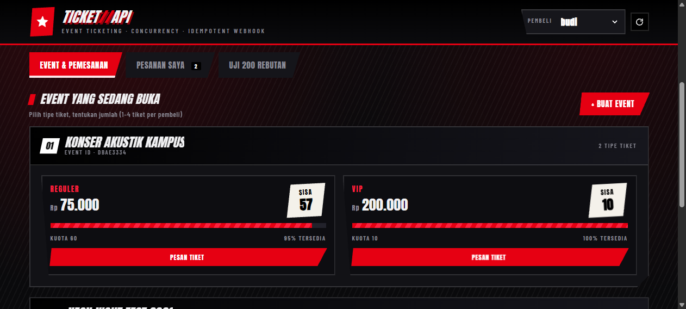
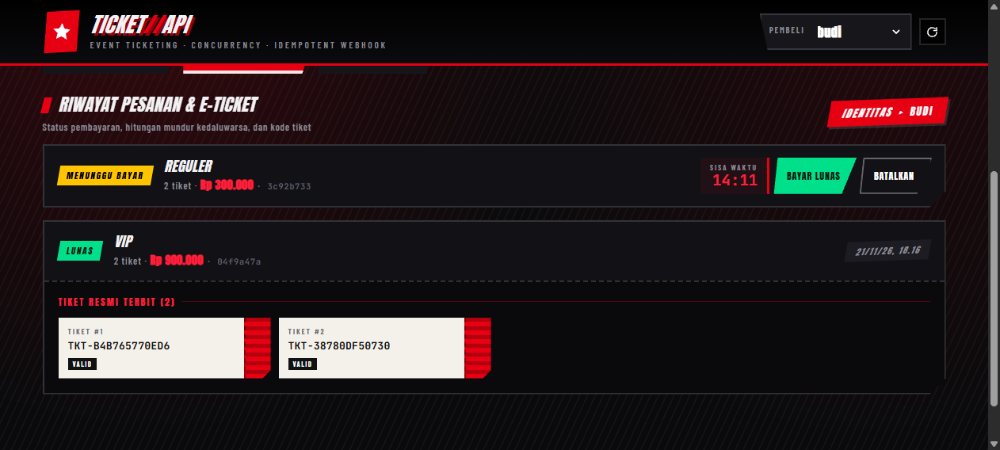
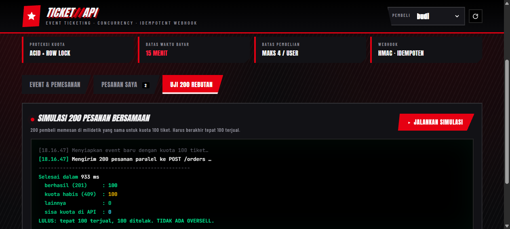

# Ticket API — Penjualan Tiket Event dengan Kuota Terbatas

Backend API untuk menjual tiket event kecil dengan kuota terbatas saat banyak orang membeli
di menit yang sama: **tidak pernah oversell**, kuota tertahan 15 menit, maksimal 4 tiket per
pembeli, satu pesanan tidak pernah menerbitkan tiket dua kali, webhook pembayaran idempoten,
plus web dashboard opsional untuk demo.

**Stack:** Node.js 22 · TypeScript · Express · PostgreSQL 16 · Nginx (reverse proxy) · Docker Compose · Vitest · GitHub Actions.

```
Repo:      https://github.com/nafis811/ticket-api
Jalan:     docker compose up --build      →  http://localhost:3300
```

---

## 1. Menjalankan Sistem (satu perintah)

Syarat: Docker Desktop / Docker Engine + Docker Compose v2. Tidak perlu Node.js atau PostgreSQL di mesin host.

```bash
docker compose up --build
```

Lalu buka **http://localhost:3300** (web dashboard) atau **http://localhost:3300/health**.

Yang hidup dari satu perintah itu:

| Service | Isi | Port host |
|---|---|---|
| `db` | PostgreSQL 16 + volume `pgdata` (data tidak hilang saat restart) | tidak dibuka ke host |
| `api` | Node.js API (multi-stage image, `USER node`, healthcheck) | tidak dibuka ke host |
| `nginx` | Reverse proxy — satu pintu masuk, sekaligus menyajikan dashboard | **3300** |

Database tidak di-publish ke host: hanya `api` yang boleh bicara ke database, lewat
user-defined bridge network `app-net`.

Stop: `docker compose down` · hapus data juga: `docker compose down -v`

### Tampilan dashboard





---

## 2. Alur demo (5 menit)

Dashboard di `http://localhost:3300` sudah memuat semua langkah ini secara visual
(tab **Event & Pemesanan**, **Pesanan Saya**, **Uji 200 Rebutan**).

1. **Buat event** — tombol *+ Buat Event*, atau kalau kosong pakai *Buat Event Sampel* (100 Reguler / 20 VIP).
2. **Lihat sisa kuota** — tiap tipe tiket menampilkan kuota, harga, dan sisa.
3. **Pesan tiket** — pilih tipe + jumlah 1–4. Pesanan langsung `PENDING` dan kuota **langsung turun**.
4. **Batas 4 tiket** — coba pesan lagi dengan pembeli yang sama: ditolak `LIMIT_EXCEEDED`.
5. **Bayar** — tombol *Bayar Lunas*: tiket terbit dengan kode unik (`TKT-…`).
6. **Bayar dua kali** — tiket tetap sama, tidak ada tiket baru.
7. **Batalkan / kedaluwarsa** — kuota kembali seketika.
8. **Uji 200 rebutan** — tab ketiga: 200 pesanan bersamaan → tepat 100 terjual.

Versi curl-nya:

```bash
# 1. Buat event (wajib tepat dua tipe: Reguler & VIP)
curl -s -X POST http://localhost:3300/events -H 'Content-Type: application/json' -d '{
  "name": "Konser Musik Indie 2026",
  "ticket_types": [
    {"name": "Reguler", "price": 100000, "quota": 100},
    {"name": "VIP",     "price": 300000, "quota": 20}
  ]
}'

# 2. Lihat event + sisa kuota
curl -s http://localhost:3300/events

# 3. Pesan 2 tiket (identitas pembeli = header X-User-Id)
curl -s -X POST http://localhost:3300/orders -H 'Content-Type: application/json' \
  -H 'X-User-Id: budi' -d '{"ticket_type_id": "<ID_TIPE_TIKET>", "quantity": 2}'

# 4. Tandai lunas → tiket terbit
curl -s -X POST http://localhost:3300/orders/<ORDER_ID>/pay

# 5. Riwayat pesanan + kode tiket
curl -s http://localhost:3300/orders -H 'X-User-Id: budi'
```

---

## 3. Endpoint

| Method | Endpoint | Keterangan | Header |
|---|---|---|---|
| `GET` | `/health` | Health check (dipakai Docker + CI) | — |
| `POST` | `/events` | Buat event + dua tipe tiket (Reguler & VIP) | — |
| `GET` | `/events` | Semua event + sisa kuota terkini | — |
| `GET` | `/events/:id` | Detail satu event + sisa kuota | — |
| `POST` | `/orders` | Pesan 1–4 tiket → `PENDING`, kuota tertahan 15 menit | `X-User-Id` |
| `GET` | `/orders` | Riwayat pesanan + tiket milik pembeli | `X-User-Id` |
| `GET` | `/orders/:id` | Detail satu pesanan | `X-User-Id` |
| `POST` | `/orders/:id/cancel` | Batal sebelum bayar → kuota langsung kembali | `X-User-Id` |
| `POST` | `/orders/:id/pay` | Simulasi pembayaran lunas → terbitkan tiket | — |
| `POST` | `/webhooks/payment` | Webhook provider (HMAC-SHA256, idempoten) | `X-Signature` |

Bentuk error selalu sama: `{ "error": { "code": "SOLD_OUT", "message": "…" } }`.

Kode status yang dipakai: `400` validasi · `401` tanpa `X-User-Id` / signature salah ·
`404` tidak ditemukan · `409` kuota habis / batas 4 tiket / sudah tidak bisa dibayar · `201` pesanan dibuat.

---

## 4. Menandai Pesanan Lunas

Tiga cara, pilih sesuai kebutuhan demo:

**a. Endpoint (paling cepat)**

```bash
curl -X POST http://localhost:3300/orders/<ORDER_ID>/pay
```

**b. Skrip CLI** (butuh Node.js di host)

```bash
npm run pay -- <ORDER_ID>
```

**c. Webhook pembayaran — pola provider sungguhan (nilai tambah)**

```bash
npm run webhook -- <ORDER_ID> --twice
```

```text
kirim #1 -> HTTP 200 {"duplicate":false,"outcome":"PAID"}
kirim #2 (duplikat, harus 200 + duplicate:true) -> HTTP 200 {"duplicate":true,"outcome":"PAID"}
```

Payload + signature yang dikirim skrip itu:

```json
{ "event_id": "evt-1750", "order_id": "<ORDER_ID>", "status": "paid" }
```

`X-Signature` = `HMAC-SHA256(hex)` dari **body mentah** memakai `WEBHOOK_SECRET`
(default compose: `dev-webhook-secret`). Sistem menangani tiga hal yang bikin webhook susah:

| Kasus | Perilaku |
|---|---|
| Dikirim dua kali / bersamaan | Diproses **sekali**. `event_id` provider jadi PRIMARY KEY di tabel `payment_events`, dicatat di transaksi yang sama dengan perubahan pesanan. |
| Tiba setelah 15 menit (pesanan sudah `EXPIRED`) | **Tidak** menerbitkan tiket (kuota sudah dilepas ke pembeli lain), dicatat `LATE_PAYMENT_REFUND_NEEDED`. |
| Signature salah / `order_id` bukan UUID | Ditolak `401` / `400`; tidak ada yang tercatat, provider boleh kirim ulang. |

---

## 5. Test Otomatis

22 test, memakai **PostgreSQL sungguhan** (bukan mock) karena inti soal ini ada di perilaku transaksi database.

```bash
# 1. Nyalakan database
docker compose up -d db

# 2. Siapkan database terpisah untuk test (test meng-TRUNCATE tabel)
docker compose exec db psql -U postgres -c "CREATE DATABASE tickets_test;"

# 3. Jalankan
npm ci
npm test
```

Hasil:

```text
 ✓ tests/orders.test.ts      (13 tests)  alur pesan→tiket, kuota habis, kedaluwarsa, batas 4, pembatalan
 ✓ tests/webhook.test.ts     ( 7 tests)  signature, idempoten (8 kiriman bersamaan), late payment, validasi
 ✓ tests/concurrency.test.ts ( 2 tests)  200 pesanan bersamaan, 1 pembeli 12 request lintas tipe

 Test Files  3 passed (3)
      Tests  22 passed (22)
```

Yang dibuktikan test (bukan sekadar happy path):

- pesan → `PENDING` → bayar → tiket terbit dengan kode unik, kuota langsung tertahan;
- kuota habis → `409 SOLD_OUT`, tidak pernah oversell, kuota Reguler & VIP terpisah;
- kedaluwarsa: kuota kembali **sebelum** worker jalan (kebenaran tidak bergantung cron);
- batas 4 tiket dihitung dari semua pesanan aktif/lunas, lintas tipe, dan aman saat 12 request bersamaan;
- bayar 10x bersamaan → tetap 4 tiket, bukan 40;
- 8 webhook duplikat bersamaan → 1 diproses, tiket tidak dobel.

Test bisa juga dijalankan tanpa Node.js di host, memakai container:

```bash
docker run --rm --network ticket-api_app-net \
  -v "$PWD:/app" -v ticketapi_nm:/app/node_modules -w /app \
  -e TEST_DATABASE_URL=postgres://postgres:postgres@db:5432/tickets_test \
  node:22-alpine sh -c "npm ci && npm test"
```

---

## 6. Uji 200 Pesanan Bersamaan

```bash
npm run loadtest:docker        # dijalankan DI DALAM network Docker (disarankan)
npm run loadtest               # dari host, butuh sistem sudah jalan di localhost:3300
```

Hasil terverifikasi (kuota 100, 200 permintaan serentak):

```text
Target: http://api:3000
Mengirim 200 permintaan bersamaan untuk kuota 100...
Selesai dalam 909 ms
  berhasil (201)     : 100
  kuota habis (409)  : 100
  lainnya            : 0
  sisa kuota di API  : 0
LULUS: tepat 100 terjual, tidak ada oversell.
```



Kenapa `loadtest:docker`: di Windows/macOS, port-forward Docker Desktop membatasi lonjakan
koneksi dari host — sebagian socket bisa ter-reset (`ECONNRESET`) dan angka "lainnya" naik
padahal backend benar. Dijalankan dari dalam network Docker, tidak ada port-forward yang
dilewati. Keduanya menguji jalur kode yang sama (`POST /orders` → PostgreSQL).

Cara menjaga kuota tetap benar: satu transaksi PostgreSQL dengan **row lock** pada baris
`ticket_types` (`SELECT … FOR UPDATE`), hitung terjual **di dalam** transaksi itu, baru `INSERT`.
200 permintaan untuk tipe tiket yang sama mengantre di lock, jadi hitungannya tidak bisa berubah
di tengah jalan. Detail lengkap + trade-off: [DECISIONS.md](DECISIONS.md).

---

## 7. CI/CD

`.github/workflows/ci.yml`, jalan setiap `push`:

1. **`test`** — service PostgreSQL 16, `npm ci`, `npm run typecheck`, `npm test`. Gagal di sini = tidak ada image.
2. **`build-and-push`** (butuh `test` lulus) — build image, push ke GHCR dengan tag **commit SHA**
   (`ghcr.io/nafis811/ticket-api:<sha>`) plus `latest` hanya untuk default branch.

Ambil image versi tertentu: `docker pull ghcr.io/nafis811/ticket-api:<commit-sha>`.

---

## 8. Struktur Repo

```text
src/
  app.ts             middleware, static dashboard, error handler
  server.ts          start: migrate → expiry worker → listen
  db.ts              pool, withTx(), migrate() dengan advisory lock
  schema.sql         tabel events, ticket_types, orders, tickets, payment_events
  http.ts            asyncHandler, validasi UUID, X-User-Id
  routes/            events, orders, webhooks (tipis — tanpa logika bisnis)
  services/
    orders.ts        createOrder, cancelOrder, applyPayment  ← inti transaksi
    events.ts        ACTIVE_ORDER_SQL (definisi "pesanan yang memakan kuota")
    expiry.ts        worker housekeeping 30 detik
    webhook.ts       verifikasi HMAC + idempotensi
tests/               22 test integrasi (PostgreSQL sungguhan)
scripts/             load-test.mjs, webhook-demo.mjs, pay.ts
public/index.html    dashboard demo (tanpa build step, tanpa framework)
nginx/nginx.conf     reverse proxy + keepalive ke api
```

---

## 9. Konfigurasi

| Env | Default | Arti |
|---|---|---|
| `DATABASE_URL` | `postgres://postgres:postgres@db:5432/tickets` | koneksi database |
| `PORT` | `3000` | port API di dalam container |
| `ORDER_TTL_SECONDS` | `900` | kuota ditahan 15 menit |
| `EXPIRY_INTERVAL_MS` | `30000` | interval worker housekeeping |
| `WEBHOOK_SECRET` | `dev-webhook-secret` | kunci HMAC webhook |

Untuk mempercepat demo kedaluwarsa (mis. 30 detik), ubah di `docker-compose.yml`:

```yaml
ORDER_TTL_SECONDS: "30"
```

lalu `docker compose up -d --force-recreate api`.

---

## 10. Kalau Ada Masalah

| Gejala | Sebab / solusi |
|---|---|
| `port is already allocated` | Port 3300 dipakai proses lain: ubah `"3300:80"` di `docker-compose.yml`. |
| `api` restart terus, log `EAI_AGAIN db` | Docker Desktop belum siap saat `api` start; `restart: unless-stopped` mencoba lagi, biasanya pulih < 10 detik. |
| Dashboard kosong / "API Tidak Terjangkau" | Cek `docker compose ps` dan `curl localhost:3300/health`. |
| `npm run loadtest` dari host banyak `ECONNRESET` | Batas port-forward Docker Desktop — pakai `npm run loadtest:docker`. |